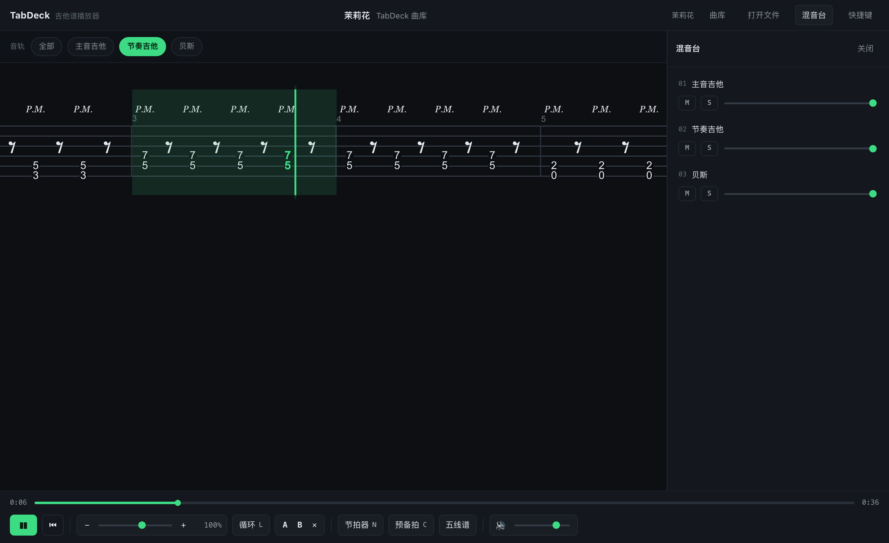

# TabDeck · 本地吉他谱播放器

一个 Songsterr 风格的网页播放器：**把 Guitar Pro / MusicXML 谱拖进去，就能播放、变速、AB 循环、分轨静音地练琴**。纯前端静态页，零后端、零账号、零上传。

自带的能力，恰好是 Songsterr 免费版锁在订阅后面的那部分：变速、循环、单轨静音/独奏、节拍器、预备拍。

**在线版：<https://tab.doublexing.cc>**（部署在 Cloudflare Workers 静态资源上）



## 快速开始

```sh
./serve.sh            # 等价于 python3 -m http.server 8777 --bind 127.0.0.1
# 然后打开 http://127.0.0.1:8777/
```

也可以用 `npm run serve`。

> **必须走 http，不能直接双击 `index.html`。** 页面用的是 ES module worker + AudioWorklet，`file://` 下浏览器会拦掉，音色库和渲染都会失败。页面检测到 `file://` 会给出提示。

首次打开想先看效果：点「载入内置示例」（一段自写的 E 小调五声 riff，无版权问题）。

## 部署到 Cloudflare Workers

```sh
wrangler deploy
```

配置在 `wrangler.jsonc`：Worker 名 `tabdeck`，静态资源目录 `.`，自定义域 `tab.doublexing.cc`。

`.assetsignore` 把开发文件挡在上传之外 —— 线上只有 15 个文件（`index.html` + `vendor/`），`node_modules`、`tools/`、`screenshots/`、测试 fixture 都不会被发布，源码文件在线上返回 404。


## 曲库

按 `B` 或点顶栏「曲库」打开。22 首，分六类：

| 分类 | 数量 | 内容 |
| --- | --- | --- |
| 中国风 · 公有领域 | 7 | 茉莉花、阳关三叠、彩云追月、二泉映月、渔舟唱晚、春江花月夜、金蛇狂舞 |
| 中国风 · 原创 | 2 | 中国风摇滚 Riff、五声 Solo 练习 |
| 布鲁斯 | 2 | 12 小节 Shuffle（真三连音记谱）、慢速布鲁斯带 Turnaround |
| 节奏 / Riff | 2 | Power Chord 进行套路、闷音节奏 Riff |
| 技巧专项 | 6 | 五声五个把位（0–10 品五盒型）、交替拨弦、推弦与颤音、自然泛音、点弦、扫拨琶音 |
| 风格练习 | 3 | 金属 Riff（218 个闷音）、Funk 十六分切分、后摇 Clean 分解 |

**9 首是完整的三轨电吉他编曲**（中国风 7 首 + 原创 2 首）：`主音吉他`（过载/失真，带推弦、人工泛音、点弦）+ `节奏吉他`（强力和弦 + 手掌闷音）+ `贝斯`。载入后可以用顶部的音轨胶囊切换，或在混音台里单独静音/独奏任一轨来跟弹 —— 这正好把播放器的分轨能力用上了。

其余 13 首是单轨的技巧/风格练习曲，各自解决一个具体技术点（闷音颗粒、交替拨弦均匀度、推弦音准、扫拨三和弦性质等）。

谱面以 alphaTex 文本存在 `scores/*.alphatex`，索引在 `scores/index.json`（每条都标注了版权出处）。

### 为什么曲库里没有流行歌

**能收的**：公有领域的中国作品（作者逝世满 50 年，中国《著作权法》第 23 条），改编版权归本仓库；以及原创练习曲。

**不能收的**：现代流行歌曲的记谱。Beyond《海阔天空》、黑豹《无地自容》这类曲目，网上能搜到的谱绝大多数是网友无授权记谱，**把它们收进一个公网可访问、挂着你自己域名的站，法律风险直接落在站点所有者身上**（Songsterr 就是靠买授权活着，它帮助页写着把近一半收入当版税付出去）。

想练这些曲子，两条正路：一是自己手上有 `.gp` 文件，用「打开文件」本地加载（本站不存储、不上传）；二是走授权渠道拿官方谱。

### 加自己的曲目

1. 把 `.alphatex` 放进 `scores/`
2. 在 `scores/index.json` 的 `scores` 数组里加一条（id / title / category / difficulty / tags / source / file）
3. 跑 `npm run check:scores` 校验小节是否写满、能否被引擎解析

alphaTex 是文本记谱格式，语法见 [官方文档](https://www.alphatab.net/docs/alphatex/introduction)。写谱时实测出来的几个坑：

- **`(和弦){pm}` 解析不了**（和弦后接闷音），要把技法写进每个音里：`(0.6{pm} 2.5{pm})`；单个音符同理，`0.6{v}{pm}` 这种两组花括号也不行，得合成一组 `0.6{v pm}`。
- **附点（`:4.`）、延音线（`0.6-`）在 1.8.4 里不可用** —— shuffle 律动要用真三连音记谱（`:8 {tu 3} X :12 {tu 3} Y` 之类）才能既准又合法。
- **alphaTab 内部 `note.string` 的 1 是最细的高音弦**，和 alphaTex 里 `品.弦` 的 1 = 最粗 6 弦正好相反；拿它做音高分析时容易把指型算反。
- 多轨要用 `\track "名字"` 分段，每轨可以有自己的 `\instrument` 与 `\tuning`；**每个文件里所有轨的小节数必须一致**。

## 支持的谱面格式

| 格式 | 扩展名 | 说明 |
| --- | --- | --- |
| Guitar Pro 3/4/5 | `.gp3` `.gp4` `.gp5` | 老版本二进制格式 |
| Guitar Pro 6 | `.gpx` | |
| Guitar Pro 7/8 | `.gp` | 现在最通用的格式 |
| MusicXML | `.musicxml` `.xml` `.mxl` | 开放标准，MuseScore / Finale / Sibelius 都能导出 |
| CapXML | `.cap` `.capx` | Capella |
| alphaTex | `.tex` `.alphatex` | alphaTab 自家的文本记谱格式 |

## 功能

- **内置曲库（22 首）**：按 `B` 打开，可搜索、按分类筛选、按难度标注；点一下直接载入
- **拖放即用**：整个窗口接受拖放，也可以点「打开文件」
- **播放器**：播放/暂停、回到开头、点进度条任意跳转
- **滑窗滚动（Songsterr 手感）**：横向一行铺开，播放时谱面连续滑过去，绿色播放指针钉在视口左侧约 1/3 处，当前小节整节高亮，正在弹的音符染成绿色
- **变速 25%–150%**：滑杆或 `−`/`+`，不改音高
- **循环**：整曲循环开关；A/B 两点循环（在播放中按 A、B 取当前小节），进度条上会画出区间
- **分轨**：顶部胶囊切换显示哪条音轨；混音台里逐轨静音/独奏/调音量（多轨编曲可拆开跟弹）
- **节拍器 + 预备拍**
- **六线谱 / 五线谱** 一键切换
- **偏好本地记忆**：速度、循环、节拍器、音量、谱表显示存在 localStorage，刷新后还在
- **深色主题**：alphaTab 默认是「白纸黑墨」，这里另外配了一套深色渲染色

## 快捷键

| 键 | 作用 |
| --- | --- |
| `空格` | 播放 / 暂停 |
| `←` `→` | 后退 / 前进 1 秒 |
| `Home` / `End` | 回到开头 / 跳到结尾 |
| `S` / `Shift+S` | 减速 / 加速 5% |
| `L` | 循环开关 |
| `A` / `B` | 设循环起点 / 终点 |
| `N` / `C` | 节拍器 / 预备拍 |
| `M` | 静音当前音轨 |
| `1`–`9` / `0` | 只显示第 N 轨 / 显示全部 |
| `I` | 混音台 |
| `?` | 快捷键面板 |
| `Esc` | 关闭面板 |

## 实现

```
index.html                 # 全部 UI + 逻辑，单文件
vendor/alphatab/           # 本地化的 alphaTab 运行时（引擎、Bravura 字体、sonivox 音色库）
scores/                    # 曲库：index.json + 22 个 .alphatex 谱面
fixtures/demo.gp           # 测试用谱（脚本生成，16 小节）
tools/make-fixtures.cjs    # 生成 fixtures/demo.gp
tools/check-scores.mjs     # 曲库校验（真实解析 + 小节拍数核对）
tools/verify.mjs           # 浏览器冒烟测试（内置静态服务 + Playwright）
screenshots/               # verify 跑出来的截图
```

引擎是 [alphaTab](https://www.alphatab.net/)：它一家包办了工程里最难的四个模块 —— 格式解析（GP3–GP8 / MusicXML / CapXML / alphaTex）、六线谱排版（Bravura SMuFL 字体）、音频合成（内置 TinySoundFont 的 MIDI 合成器）、以及光标同步交互。所以这个播放器本身只做了三件事：外壳 UI、把练习功能接到 alphaTab 的 API 上、以及深色主题配色。

几个踩过的坑，都写在代码注释里了：

1. **`playerMode` 不能传 `'enabled'`** —— 1.8.x 的 `PlayerMode` 只有 `EnabledAutomatic` / `EnabledSynthesizer` / `EnabledBackingTrack` / `EnabledExternalMedia`，传错字符串不会报错，而是**静默降级成 Disabled**，表现是播放键按了没反应、`endTime` 为 0。代码里直接用了导入的枚举对象。
2. **`soundFontLoaded` / `soundFontLoadFailed` 不在 `AlphaTabApi` 上**，只挂在 `api.player` 上，而 `player` 在构造时还没创建。用 `isReadyForPlayback` 轮询兜底。
3. **`timePosition` 是「输出时间」**：变速时整条时间轴被拉伸（0.5× 时 38.4s 的曲子总时长显示 76.8s），所以它和墙钟始终 1:1。要判断速率得看 tick 推进速度。
4. **深色主题必须自己配 `display.resources` 颜色**，否则五线谱和品位数字是黑墨画在深底上，基本看不见。
5. **播放指针要自己配色**：alphaTab 只给光标元素加 `at-cursor-bar` / `at-cursor-beat` 这些 class，**既不设颜色、官方包里也根本没有 css 文件**。不自己写 CSS 的话指针是个透明的空 div —— 谱面在滑，但你完全看不出播到哪了。
6. **滚动模式决定手感**：`OffScreen`（默认之一）是光标自己在谱面上往右跑、出屏才翻页；`Smooth` 才是谱面按播放速度持续滑过去。另外指针默认被钉在视口最左边、当前小节被切掉一大半，要用 `scrollOffsetX`（实测与指针屏幕位置 1:1）把它推到 1/3 处。
7. **`tickPosition = 0` 之后视口不会自己回去**：alphaTab 只在播放过程中自动滚动，所以任何跳转（回到开头、点进度条、方向键）之后都要补一个 `api.scrollToCursor()`，否则指针直接飞出屏幕。

## 验证

```sh
npm install
npx playwright install chromium   # 首次
npm run fixtures                  # 生成 fixtures/demo.gp
npm run check:scores              # 校验曲库（解析 + 小节拍数是否写满）
npm run verify                    # 39 项检查 + 截图
npm run verify:all                # 上面两个一起跑
```

`npm run verify` 会起一个内置静态服务，用真实 Chromium 加载真实 `.gp` 文件，逐项断言：

- 解析、SVG 渲染、播放器就绪、总时长正确
- 深色配色真的生效（按渲染出的 SVG 元素 fill 颜色统计，不是看配置）
- **变速真的改变播放速率**：量 tick 推进速率，1.0× vs 0.5× 实测比 2.01
- **滑窗真的在滑**：断言 `scrollLeft` 在播放中增长、指针落在视口 15%–50% 之间、指针背景色非透明
- **AB 循环真的回卷**：断言播放位置始终落在 A/B 区间内
- **「回到开头」真的归零**：断言 tick 回 0 且指针回到视口内
- 时间轴随速度拉伸、六线谱切换、混音台静音、刷新后偏好保留
- **曲库可用**：面板列出全部曲目、搜索过滤生效、从曲库载入的曲目确实被渲染出来
- **多轨没丢轨道**：多轨编曲载入后是 3 轨（主音/节奏/贝斯）、音轨胶囊齐全、能对节奏吉他单独静音；真实多轨 `.gp` 文件同样 3/3 轨
- 全程无控制台报错、无失败请求

另外 `npm run check:scores` 会把曲库里每一首都真实解析一遍，并逐小节核对拍数是否写满（4/4 的小节必须正好 4 拍）——写谱时最容易犯的错就是这个。

当前状态：**曲库 22/22 通过 · 浏览器测试 39/39 通过**。

## 已知限制

- 只在 Chromium 里验证过；Safari / Firefox 没测（alphaTab 本身支持，但这套 UI 没测过）
- 移动端能打开，但没有针对触摸做手势优化
- 没有谱库、没有搜索、没有用户系统 —— 这是刻意的，见下
- 变速是「时间轴拉伸」语义，所以进度条总时长会随速度变化（0.5× 时 38.4s 显示成 76.8s）。这是 alphaTab 的模型，不是 bug
- 跳转到曲尾时指针会贴在视口左侧（内容已滑到底，没有更多余量），这是滚动容器的物理限制

## 版权

**这个项目不托管、不分发任何乐谱。** 页面只在你自己的浏览器里解析你提供的文件，不上传、不落盘、不索引。

这一点是刻意设计的。网上能免费下到的吉他谱，绝大多数是网友对版权歌曲的记谱，没有授权；把它们收集、托管、公开索引，风险就从原站点转移到你身上 —— Songsterr 自己就是靠买授权活着（它帮助页写着把近一半收入作为版税付出去）。所以：

- **自用**：随便用，把你手上任何 `.gp` 拖进来就行。
- **想公开上线**：只放公有领域的谱（[PDMX](https://github.com/pnlong/PDMX) 有 25 万+ 首公有领域 MusicXML，注意用它的 `no_license_conflict` 子集；OpenScore、Mutopia 同理），或者只做「播放器 + 用户自己导入文件」这种形态，自己不存谱。
- **想放流行歌**：得走授权（国内音著协 MCSC，海外出版商 / Harry Fox / CMRRA），这是另一个量级的成本。

## 依赖许可

| 组件 | 许可 |
| --- | --- |
| 本项目代码 | MIT |
| [alphaTab](https://github.com/CoderLine/alphaTab) | MPL-2.0（文件级 copyleft：不改它自身的文件即可商用闭源；改了那些文件就要公开改动） |
| Bravura 字体 | SIL OFL 1.1 |
| sonivox 音色库 | Apache-2.0（来自 AOSP） |
